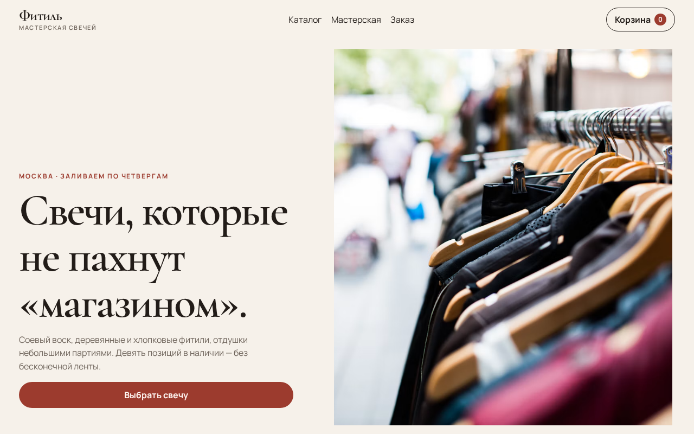

# Мастерская свечей «Фитиль»

Демо: https://swattt555333.github.io/candle-shop/

Небольшой интернет-магазин свечей ручной заливки. Покупатель выбирает позицию из короткого каталога, кладёт её в корзину и оставляет контакты для самовывоза или курьера. Оплаты нет: после проверки формы заказ остаётся на экране, а корзина очищается.

## Что умеет сайт

- Каталог из девяти свечей хранится массивом в `js/main.js` и рисуется на странице скриптом. У каждой позиции есть цена, вес, время горения, категория и фотография.
- Фильтр по категориям: соевые, ароматические, без аромата, наборы. Сортировка: исходный порядок мастерской, сначала дешевле, сначала дороже. Фильтр и сортировка работают вместе.
- Кнопка «В корзину» добавляет одну штуку и открывает панель корзины. Повторное нажатие пишет «Ещё одну». В панели можно уменьшить, увеличить (не больше девяти) или убрать позицию. Сумма пересчитывается сразу.
- Корзина записывается в `localStorage` под ключом `fitil-cart-v1`. После обновления страницы и при переходе к оформлению состав сохраняется. Если товар исчез из массива, скрипт его выбрасывает.
- Страница `checkout.html` показывает строки заказа, переключатель доставки (самовывоз 0 ₽ или курьер по Москве 390 ₽) и итог. Форма проверяет имя, телефон, почту, город, согласие с демонстрационным режимом и адрес, если выбран курьер. Пустую корзину отправить нельзя.
- После успешной проверки появляется номер вида «Ф-» и шесть цифр, корзина очищается, поля скрываются. На сервер ничего не уходит.
- Бургер на узком экране, закреплённая шапка, плавная прокрутка к якорям, появление блоков при скролле.

## Технологии

- Две HTML-страницы, один файл CSS и один файл JavaScript. Без React, без сборщика, без npm внутри этого проекта.
- Шрифты Cormorant Garamond и Manrope с Google Fonts.
- Фотографии по прямым ссылкам Unsplash.

## Структура

```text
candle-shop/
├── index.html        витрина: первый экран, каталог, мастерская, панель корзины
├── checkout.html     состав заказа, доставка и форма контактов
├── css/style.css     палитра, карточки, корзина, форма
├── js/main.js        массив товаров, фильтр, сортировка, корзина, проверка заказа
├── img/favicon.svg   значок вкладки
├── img/screenshot-desktop.png
├── img/screenshot-mobile.png
└── README.md
```

## Как открыть локально

1. Сохраните папку `candle-shop` целиком.
2. Откройте `index.html` двойным щелчком.
3. Добавьте свечу, обновите страницу — счётчик в шапке должен остаться. Затем откройте «Оформить заказ».
4. `localStorage` в некоторых браузерах не работает, если страница открыта в режиме, где хранилище запрещено. Тогда корзина живёт только до перезагрузки.

## Как опубликовать на GitHub Pages

1. Создайте публичный репозиторий, например `candle-shop`.
2. Загрузите в корень `index.html`, `checkout.html` и папки `css`, `js`, `img`.
3. Settings → Pages → Branch `main`, папка `/root` → Save.
4. Откройте `https://swattt555333.github.io/candle-shop/`.
5. Проверьте, что ссылка «Оформить заказ» ведёт на `checkout.html` рядом, а не на чужой адрес. Корзина общая для обеих страниц, потому что ключ хранилища один.

## Скриншоты




## Автор

InterPanic
